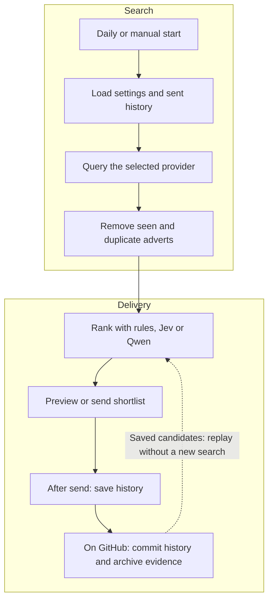

# London finance jobs bot

This bot asks Adzuna or JSearch for recent London-area finance vacancies, removes listings that
have already been emailed, and sends a daily shortlist through Gmail. It can
run locally or on GitHub Actions, triggered each morning by Cloudflare. Python
owns fetching, history and email delivery; suitability can use rules, Jev or Qwen.

JSearch is currently selected, with Adzuna fallback disabled. Its eight-page
search is followed by Jev ranking. A £50,000 cap excludes known annual GBP salary
figures above that amount, including estimates; missing pay or unknown units
remain eligible, so this cannot guarantee that every selected job pays below the cap.
In Jev mode a separate salary question also reads pay wording in the description.
It excludes above-cap base pay and crossing ranges, while treating commission-only
figures, fees and unstated base salaries as unknown. Decisions are saved in receipts;
missing provider salary figures are not replaced with invented amounts.
When a clear salary range is extracted from the description, emails label it
“extracted from advert”; unknown pay is labelled explicitly. See the
[saved example email](reports/2026-11-23_jev_salary_trial/email-example.md).
When configured as the primary source, Adzuna can use JSearch as backup after an HTTP error or no
unseen matching jobs, or as a top-up when Adzuna returns 25 jobs or fewer. This
application does not separately scrape job boards or promise coverage of any
particular recruitment website. Adzuna requires a finance category and finance
title terms when rules are selected. JSearch rules can also use descriptions.
Jev and Qwen instead assess the available advert text against the candidate
profile and shared categories. The target is a Finance and Accounting master's
graduate with 0–2 years' experience; graduate training and relevant complaints
operations are eligible, while legal occupations and mid-level/senior work are
excluded. This screens for plausible matches, not verified eligibility.
See [switching sources](docs/JSEARCH.md) and [model selection](docs/JEV_RANKING.md).



**Replay** means loading a saved batch of vacancies and assessing it again, for
example to compare rules, Jev and Qwen on the same jobs without another Adzuna or
JSearch request. Model assessments can still cost money; replay does not by itself
send an email or update sent-job history. The manual **Compare finance job rankings**
workflow provides this experiment separately from the normal morning delivery.

The diagram shows the daily route and its replay branch. GitHub also runs separate
**Code checks** before delivery is allowed and **Preserve run evidence** afterwards,
which saves candidates, assessments and available email reports for later inspection.
Cloudflare schedules the daily route and checks whether delivery was recorded;
it does not rank jobs.

## Try it locally

Run commands from the project root with Python 3.12 or later. The bot uses only
Python's built-in libraries, so there are no application dependencies to install
and no virtual environment is required.

Your credential setup must supply `JSEARCH_API_KEY` for the current JSearch source.
`ADZUNA_APP_ID` and `ADZUNA_API_KEY` are needed only if you select Adzuna again. Names
are case-sensitive. Sending also needs `gmail_app_password`. Keep their values
in your user-managed secret configuration, never in this repository or a command.
The Gmail app label is only a label; it is not the sender address or password.

On this machine, the existing credential launcher supplies those settings:

```bash
/home/nodozi/.local/bin/run-with-secrets python3 -m jobs_bot
```

This command searches the selected provider and prints the proposed email body. It does not send
email or change the sent-job history. With the default configuration, a run makes
one eight-page JSearch search. Each page uses provider credits, even though the
pages are requested in one HTTP call. If switched back to Adzuna, it makes
one combined search, requesting 400 listings on the first page. HTTP 400
triggers one retry requesting 100. That means one API request normally, two if
the fallback is used. Smaller successful responses are accepted without more
requests. If Adzuna still returns an HTTP error or leaves no unseen matching jobs,
the configured JSearch backup makes one eight-page search. If both sources have
no matches, the normal email says 'No matching jobs found today'. If JSearch
fails, send mode emails a distinct failure notice and the run still fails
visibly. Gmail acceptance records that day's email, including a failure notice;
seen-job keys stay untouched on failure. Neither requested Adzuna page size is guaranteed by a
live test; Adzuna's published parameter schema gives no maximum.

When you want to send that kind of shortlist, use:

```bash
/home/nodozi/.local/bin/run-with-secrets python3 -m jobs_bot --send
```

The send command performs a fresh search. Addresses are supplied through runtime
settings, not the tracked configuration. Locally, `GMAIL_SENDER` is the Gmail
login address, `email_user` is the main recipient and `email_friend` is an
optional second recipient. Both recipients appear in the To field. Preserve
recipient spelling, including any plus tag, but use the actual Gmail login
address for the sender. These values belong in your user-managed secret setup.

On another machine where the settings are already supplied securely to the
process, use `python3 -m jobs_bot` or `python3 -m jobs_bot --send` directly.
The launcher shown above belongs to this machine and is not shipped with the bot.

## Adjust the shortlist

`config.toml` holds search terms, the London search radius, how many days back to
look, how many results to request, title preferences, title exclusions, email
connection settings and the history path. Addresses and passwords are supplied
separately. The default shortlist contains at most 20 jobs
from listings added within seven days, with no minimum salary.

With Adzuna, `query_terms` are finance-related alternatives combined in one
`what_or` search within Adzuna's Accounting & Finance category. Python also
requires the returned category to match and at least one configured finance
term in the title before junior preferences or senior exclusions. This saves
requests but can reduce coverage compared
with separate searches; a broad result pool may contain fewer junior roles.
`results_per_page = 400` and `fallback_results_per_page = 100` control the primary
and fallback sizes. No additional pages are fetched. Edit these shortlist settings
in `[search]`:

| Setting | Effect |
|---|---|
| `category` | Restrict the request and returned jobs to `accounting-finance-jobs`. Missing or different categories are excluded. |
| `max_experience_years` | Set the experience limit used to assess explicit mandatory applicant requirements. The default is 2 years. Zero and fractional values are supported. |
| `title_keywords` | Require at least one whole finance word/phrase in the title. |
| `exclude_title_keywords` | Reject whole words/phrases such as senior, manager, director, VP and controller, plus recruiter titles. |
| `preferred_title_keywords` | Prefer graduate, junior, trainee, entry-level and assistant titles within each experience group. |
| `deprioritise_title_keywords` | Put associate titles below otherwise comparable titles; explicit junior wording remains stronger. |

Matching ignores case and punctuation: `Sr.` and `entry-level` work. Exclusions
win, so Assistant Manager is rejected while Finance Assistant remains eligible.
Roles with explicit requirements compatible with the experience limit come first,
then junior title preferences, non-associate titles and recency. Equal ranks retain
provider order. Finance keyword count does not affect rank. Finance Analyst and
Credit Analyst remain eligible. A bare Junior Analyst title lacks finance
evidence and is excluded.
The bot sends
fewer than 20 jobs if fewer qualify; it never pads the shortlist with excluded jobs.
Logs count exclusions for wrong/missing category, missing finance title evidence
and the first matching senior/recruiter title term, plus experience exclusions.

Both providers use the same experience checks. These read the title and any
available description. A recognized mandatory minimum above `max_experience_years`
causes exclusion, even if the title says junior. Examples include `Requires 3+
years experience` and `The successful candidate must have 5 years experience`.
The default limit is two years. Changing this limit does not change the existing
finance relevance or senior-title filters.

Decimal values are compared as written. With the default limit, `1.5 years
experience required` remains eligible; `2.5 years experience required` does not.
Ranges use their lower endpoint. This keeps `1–3 years` and `2+ years` eligible.
A compatible mandatory requirement improves rank. So does an unconditional
statement such as `no experience required`.

Preferred experience does not cause exclusion or improve rank. For example,
`3 years experience preferred` remains uncertain. An unrelated preference cannot
cancel a separate mandatory minimum: `3 years experience required and Python
preferred` is still excluded. Bare experience numbers, negated requirements and
upper bounds such as `up to 5 years` remain uncertain. Missing descriptions and
experience belonging to a manager or company also remain uncertain.

Sentences containing a recognized alternative or condition are left unknown.
For example, `Requires 3 years experience or a relevant masters degree` is
retained without an experience ranking improvement. The same applies to `No
experience required for graduates; 3 years experience required for non-graduates`.
The checks do not decide whether a particular degree meets an alternative.

These English wording rules are deliberately bounded. They can miss unusual
phrasing, HTML markup, abbreviated units, or requirements absent from a truncated
description. They recognize only a small set of conditions and alternatives.
They cannot reliably connect exceptions across separate sentences or fields.
Other complex wording can also be misinterpreted. A retained role may still
demand more experience. The bot does not verify degree
requirements, professional qualifications or current student status for placement
schemes. Check the full advert; junior wording does not prove fit.

Two checks remove duplicates. An Adzuna ID catches the same advert appearing in
multiple searches or on later days. A second key uses the employer, job title and
location to catch some reposts with a new ID. This second check can also suppress
a genuinely separate vacancy with the same details. Renamed or differently
advertised jobs can still slip through. Review these trade-offs before relying
on the shortlist as an exhaustive record of vacancies.

`state/seen.json` records keys only for jobs included in successfully submitted
emails. Unselected jobs remain eligible for future shortlists. Preview does not
create this file. If a send finds no new jobs, it sends a short no-new-jobs message.
Preserve existing history when moving from local runs to GitHub, otherwise old
jobs become eligible again.

`state/delivery.json` records London dates on which Gmail accepted an email.
After one successful send, further send runs on that date exit successfully
without searching Adzuna or sending mail. This applies to manual and scheduled
runs, including a delayed schedule after a manual send. Previews remain available.
Both files are committed by the workflow; pull the latest history before a local
send. Separate checkouts do not automatically share this protection.
For a deliberate extra send, set `[email]`'s `force_send = true` in `config.toml`,
then restore `false`. This bypasses only the daily limit, not vacancy deduplication.
GitHub uses the committed config; a local edit affects only local runs.
For testing without emailing the normal recipients, choose workflow mode `test`
or run `python3 -m jobs_bot --test-send` through the credential launcher. This
sends only to `GMAIL_SENDER`, labels the subject `[TEST]`, bypasses the daily limit
and leaves both history files unchanged. Preview still sends no email. Both
preview and test search Adzuna; only the offline tests avoid external requests.

## Move to GitHub Actions

The workflow is `.github/workflows/daily-jobs.yml`, named **Daily London job
shortlist**. A small Cloudflare Worker replaces GitHub's native timer after the
02:30 schedule failed to produce a morning run. Once deployed, it requests a run
at 06:30 London time Monday–Friday, including summer clock changes. The latest
Worker also checks the saved delivery record at 06:45, requests recovery if
missing, and attempts an Ntfy alert at 07:00 if completion remains unconfirmed.
These checks need the additional settings and replacement cron in
[the Cloudflare dashboard setup](cloudflare/README.md); pushing code alone does
not deploy them. GitHub runner availability can still delay execution. The
bot independently restricts normal sends to `[email].send_weekdays`, including
manual runs with `force_send = true`. Preview and sender-only tests remain
available on weekends. The saved date confirms Gmail acceptance, not inbox
receipt, and a Cloudflare outage can stop both the timer and its checks.

Before activation, add these repository Actions secrets yourself:

| GitHub secret name | Purpose |
|---|---|
| `ADZUNA_APP_ID` | Adzuna application ID |
| `JSEARCH_API_KEY` | OpenWeb Ninja key, required only when JSearch is selected |
| `ADZUNA_API_KEY` | Adzuna API key |
| `NEBIUS_KEY` | Nebius Token Factory inference key; required for model-ranking experiments or daily `nebius_llm` mode |
| `EXA_API_KEY` | Exa advert text retrieval when `[exa] enabled = true` |
| `TYPESAFE_API_KEY` | Jev suitability ranking; required only when `ranking.method = "jev"` |
| `GMAIL_APP_PASSWORD` | Gmail app password |
| `GMAIL_SENDER` | Gmail account login address used to authenticate and send |
| `EMAIL_USER` | Main recipient address |
| `EMAIL_FRIEND` | Optional second recipient address |

Add these as repository Secrets in Settings → Secrets and variables → Actions.
If you previously created address Variables, copy their values into Secrets;
the workflow no longer reads Variables. GitHub masks supplied secret values in
logs, whereas ordinary Variables are not automatically masked. The bot also
omits email headers and recipient addresses from its preview and routine logs.

The workflow maps uppercase secret names to local runtime names: `GMAIL_SENDER`
stays uppercase, `EMAIL_USER` maps to `email_user`, `EMAIL_FRIEND` to `email_friend`,
and `GMAIL_APP_PASSWORD` to `gmail_app_password`. Adzuna names stay uppercase.
`NEBIUS_KEY` keeps the same uppercase name locally and on GitHub. The experiment
workflow passes it to the direct ranker and the agent's isolated provider proxy.
`TYPESAFE_API_KEY` also keeps its name locally and on GitHub. The normal daily
workflow maps it directly to the Jev client; no agentic workflow is involved.
It is not required while the ordinary daily bot uses rules only.
The sender must be the Gmail account whose app password you use. Google requires
two-step verification for app passwords, and some accounts restrict their use.

Upload the reviewed source to the repository's default branch. The workflow
needs permission to write repository contents because it commits updated sent
history after delivery. Branch protections may prevent this; verify that the
history commit succeeds before considering migration complete. In Actions,
choose **Run workflow**, leave the mode as **preview**, and inspect the results.
Then choose **send** for a deliberate delivery test. Cloudflare requests send mode.

The repository is currently public, including its source, job history and Actions
run logs. Sender and recipient addresses are supplied through Secrets, and the
main branch's history was rewritten on 2026-10-24 to redact previously committed
addresses. Existing downloads, forks, old run logs and GitHub cached views may
still contain earlier copies. Rewriting history cannot retract downloaded data.
Other old checkouts must be cleaned or cloned afresh; merging old history back
would reintroduce the addresses. The active local checkout was updated during
the cleanup.
Do not put addresses into tracked files or print them in workflow commands.
Repository variable values require authorized access to read; they are not a
substitute for masked Secrets when a value must stay out of public logs.

## Checks and limitations

Webpage fetching was tested and then withdrawn: it added no longer descriptions
for the saved JSearch batch. Daily ranking uses provider-supplied descriptions,
without fetching linked webpages. See [the experiment record](docs/WEB_ENRICHMENT.md).


Daily fetched candidates are now retained as **job-candidates** artifacts on each
Actions run, before suitability filtering. Their available descriptions make
later ranking comparisons possible without repeating a paid search. The separate
**Compare finance job rankings** workflow supports replay, synthetic example data,
direct Nebius assessment and an optional GitHub Agentic Workflow. It offers preview
or one test email to the sender only. The daily workflow now selects Jev in config.
Use `[ranking] method = "jev"` or `"qwen"` to choose the model;
`method = "rules"` switches model assessment off. Candidate preferences live in
`[candidate]`, and Jev's editable categories are in `prompts/jev_suitability.json`.
The profile records spoken English and Vietnamese. The shared Jev/Qwen policy
treats missing essential eligibility or boilerplate-only adverts as needing more
information, while preserving plausible junior, temporary and accounting-support
jobs. Model-ranked emails retain Adzuna's estimated-salary label and pay units.
Model assessment receipts appear as **job-ranking-receipts** Actions artifacts.
An Adzuna response of 25 jobs or fewer triggers one JSearch top-up before ranking;
the threshold is editable under `[search].jsearch_top_up_threshold`.
See [Jev setup and the model comparison](docs/JEV_RANKING.md). Local edits take
effect on GitHub after publication; Cloudflare's timer does not change.
See [the GitHub setup and experiment runbook](docs/RANKING_EXPERIMENTS.md) for the
required Secret, exact Run workflow choices, costs, archive retention and limits.

GitHub's **Code checks** workflow runs both the Python and Cloudflare test suites
on pushes and pull requests. Only pushes changing solely `state/seen.json` and
`state/delivery.json` are exempt. No API credentials or email secrets are supplied
to this workflow. The morning workflow does not repeat the suites: it requires
the latest push check on the default branch to have succeeded and verifies that
all checked-out files still match that tested commit, except the two history files.
Failed, pending, skipped or unreadable checks stop the run before searching or
sending. Open **Actions → Code checks** to diagnose or rerun a failed check.
After publishing code, wait for this workflow to pass before manually trying a
shortlist. A successful pull-request check alone does not replace the push check
for the default branch. Local coverage enforcement remains separate.

Run the offline tests with:

```bash
python3 -m unittest discover -s tests -v
```

On the configured development machine, `check-coverage` also measures Python
coverage and runs automatically before commits through the shared local Git
hook. The initial minimum is 89.66%, measured from these mocked tests. Python
network calls and child programs are blocked during that check. Its repository
settings are `.coverage-check.toml` and `.coveragerc`; the central installation
and adoption instructions are in `~/.local/share/code-quality/COVERAGE.md`.
Cloning this repository alone does not install the central tool or hook.

The tests substitute sample Adzuna results and simulated email submission. They
check application behaviour without using credentials or sending mail. They do
not establish live Gmail authentication, inbox delivery, search completeness or
whether a vacancy suits a particular applicant. A live preview checks Adzuna
access separately.

Email submission and history saving are separate operations. If Gmail accepts
mail but the local history write or GitHub history commit fails, a later run can
repeat the jobs. Partial recipient refusal can also deliver to one recipient
while leaving history unchanged. Never assume a failed run means nobody received
anything. See `DESIGN_CHOICES.md` for the accepted limitations and
`DEFERRED_WORK.md` for setup still to complete.

Each new daily run now has a readable **Daily job bulletin** on its Actions
Summary page. Fetched-job numbers and email positions link the source vacancies,
model assessments and final shortlist. Download **job-run-report** for the JSON
and prepared email body. The separate **Preserve run evidence** workflow commits
approved files under dated London-time folders in `archive/`, without automatic expiry. See
[Follow a bulletin from fetched jobs to email](docs/RUN_TRAIL.md) for exact steps.
Ordinary documentation-only pushes skip Code checks; model prompts and agent
definitions still trigger tests.

### Longer advert descriptions

The daily run retrieves text from Exa before ranking unseen vacancies. Add
`EXA_API_KEY` under GitHub → repository Settings → Secrets and variables →
Actions → Secrets → New repository secret. Local runs use the same key through
the secrets launcher. `[exa]` in `config.toml` controls `enabled`, `max_pages`
(currently 80) and `timeout_seconds` (30). Disable it to use API extracts alone.

The provider snapshot stays unchanged. Run-report candidates and ranking receipts
contain the text actually assessed; candidates also keep `original_description`,
`exa_status`, and the successful extraction URL and time. Missing, shorter or
failed extractions retain the original text and are logged. Retrieved text may
include navigation or related adverts, so a longer description does not prove
that every requirement was recovered. Text retrieval costs about $0.001 per
page, excluding subsequent Jev usage. Preview mode also performs retrieval
when enabled; it sends no email and does not update delivery history.

### Recovering a failed morning search

JSearch retries temporary server errors, network failures and unreadable JSON
at most twice, waiting 120 seconds before each retry. `[jsearch]
retry_delays_seconds = [120, 120]` controls these waits. Authentication, quota
and valid-JSON schema errors stop without retrying. Failed attempts may still
consume provider allowance. A failed search sends a notice and leaves the
workflow red, but no longer marks the day as successfully delivered.

To retry from GitHub, open Actions → Daily London job shortlist → Run workflow,
choose `send`, then Run workflow. After a successful bulletin, choose
`send-again-today` instead if another bulletin is intentional. That option
bypasses today's send limit but still excludes vacancies already delivered.
Cloudflare continues using `send`; its setup does not need changing. Existing
failure dates saved by older code are not cleared automatically: use
`send-again-today` to recover on those dates.

Jev failures appear in both the search-step logs and the run-page Summary.
A provider `max_tokens_exceeded` response is explicitly labelled as a context
token-limit failure. Each batch records vacancy/question counts, description
characters and request bytes. These sizes are not token measurements; actual
token usage is available only after successful calls. Arbitrary provider error
bodies are excluded from public logs and receipts to protect private data.
