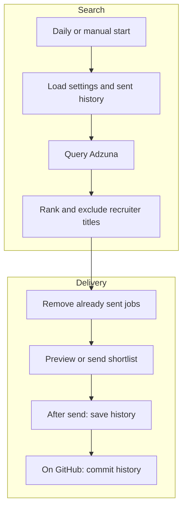

# London finance jobs bot

This bot asks Adzuna for recent London finance vacancies, removes listings that
have already been emailed, and sends a daily shortlist through Gmail. It can
run locally now and later run on GitHub Actions, GitHub's service for scheduled
program execution. No Azure service or large language model is involved.

Adzuna supplies the listings. This application does not separately scrape job
boards or promise coverage of any particular recruitment website. Search results
contain shortened descriptions and links to the adverts. Ranking uses words in
job titles, then the listing date. It is a starting shortlist, not an assessment
of a candidate's experience or eligibility.



## Try it locally

Run commands from the project root with Python 3.12 or later. The bot uses only
Python's built-in libraries, so there are no application dependencies to install
and no virtual environment is required.

Your credential setup must supply `ADZUNA_APP_ID` and `ADZUNA_API_KEY`. The names
are case-sensitive. Sending also needs `gmail_app_password`. Keep their values
in your user-managed secret configuration, never in this repository or a command.
The Gmail app label is only a label; it is not the sender address or password.

On this machine, the existing credential launcher supplies those settings:

```bash
/home/nodozi/.local/bin/run-with-secrets python3 -m jobs_bot
```

This command searches Adzuna and prints the proposed email body. It does not send
email or change the sent-job history. With the default configuration, a run makes
at most eight Adzuna requests: four search terms and up to two pages per term.

When you want to send that kind of shortlist, use:

```bash
/home/nodozi/.local/bin/run-with-secrets python3 -m jobs_bot --send
```

The send command performs a fresh search. The sender is set in `config.toml`.
The recipient comes from `email_user`, falling back to the sender if that setting
is absent. `email_friend` adds an optional second recipient. Both addresses
appear in the To field. Each setting must contain only one address.

On another machine where the settings are already supplied securely to the
process, use `python3 -m jobs_bot` or `python3 -m jobs_bot --send` directly.
The launcher shown above belongs to this machine and is not shipped with the bot.

## Adjust the shortlist

`config.toml` holds search terms, the London search radius, how many days back to
look, how many results to request, title preferences, title exclusions, email
settings and the history path. The default shortlist contains at most 20 jobs
from listings added within seven days, with no minimum salary.

Two checks remove duplicates. An Adzuna ID catches the same advert appearing in
multiple searches or on later days. A second key uses the employer, job title and
location to catch some reposts with a new ID. This second check can also suppress
a genuinely separate vacancy with the same details. Renamed or differently
advertised jobs can still slip through. Review these trade-offs before relying
on the shortlist as an exhaustive record of vacancies.

`state/seen.json` records keys only for jobs included in successfully submitted
emails. Unselected jobs remain eligible for future shortlists. Preview does not
create this file. If a send finds no new jobs, it sends a short no-new-jobs message.
Preserve existing history when moving from local runs to GitHub, otherwise old
jobs become eligible again.

## Move to GitHub Actions

The workflow is `.github/workflows/daily-jobs.yml`, named **Daily London job
shortlist**. It targets 06:30 in the Europe/London timezone, including summer
clock changes. GitHub can delay scheduled runs, so this is not a guaranteed
delivery time.

Before activation, add these repository Actions secrets yourself:

| GitHub secret name | Purpose |
|---|---|
| `ADZUNA_APP_ID` | Adzuna application ID |
| `ADZUNA_API_KEY` | Adzuna API key |
| `GMAIL_APP_PASSWORD` | Gmail app password |
| `EMAIL_USER` | Main recipient; optional if sender should receive it |
| `EMAIL_FRIEND` | Optional second recipient |

The workflow maps uppercase GitHub secret names to the names expected by the
application. The sender in `config.toml` must be the Gmail account whose app
password you use. Google requires two-step verification for app passwords, and
some accounts restrict their use.

Upload the reviewed source to the repository's default branch. The workflow
needs permission to write repository contents because it commits updated sent
history after delivery. Branch protections may prevent this; verify that the
history commit succeeds before considering migration complete. In Actions,
choose **Run workflow**, leave the mode as **preview**, and inspect the results.
Then choose **send** for a deliberate delivery test. Scheduled runs use send mode.

The repository is currently public. Source, the configured sender and any
committed job history will be visible publicly. Recipient addresses and passwords
are supplied through secrets. Decide whether to make the repository private
before publishing anything you do not want visible. Public scheduled workflows
can also be disabled after 60 days without repository activity.

## Checks and limitations

Run the offline tests with:

```bash
python3 -m unittest discover -s tests -v
```

The tests substitute sample Adzuna results and simulated email submission. They
check application behaviour without using credentials or sending mail. They do
not establish live Gmail authentication, inbox delivery, search completeness or
whether a vacancy suits a particular applicant. A live preview checks Adzuna
access separately.

Email submission and history saving are separate operations. If Gmail accepts
mail but the local history write or GitHub history commit fails, a later run can
repeat the jobs. Partial recipient refusal can also deliver to one recipient
while leaving history unchanged. Never assume a failed run means nobody received
anything. See `DESIGN_CHOICES.md` for the accepted limitations and
`DEFERRED_WORK.md` for setup still to complete.
