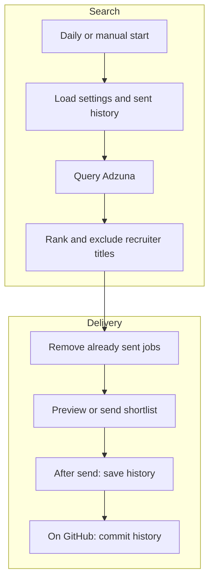

# London finance jobs bot

This bot asks Adzuna for recent London finance vacancies, removes listings that
have already been emailed, and sends a daily shortlist through Gmail. It can
run locally now and later run on GitHub Actions, GitHub's service for scheduled
program execution. No Azure service or large language model is involved.

Adzuna supplies the listings. This application does not separately scrape job
boards or promise coverage of any particular recruitment website. Search results
contain shortened descriptions and links to the adverts. Ranking uses words in
job titles, then the listing date. It is a starting shortlist, not an assessment
of a candidate's experience or eligibility.



## Try it locally

Run commands from the project root with Python 3.12 or later. The bot uses only
Python's built-in libraries, so there are no application dependencies to install
and no virtual environment is required.

Your credential setup must supply `ADZUNA_APP_ID` and `ADZUNA_API_KEY`. The names
are case-sensitive. Sending also needs `gmail_app_password`. Keep their values
in your user-managed secret configuration, never in this repository or a command.
The Gmail app label is only a label; it is not the sender address or password.

On this machine, the existing credential launcher supplies those settings:

```bash
/home/nodozi/.local/bin/run-with-secrets python3 -m jobs_bot
```

This command searches Adzuna and prints the proposed email body. It does not send
email or change the sent-job history. With the default configuration, a run makes
at most four Adzuna requests: four search terms and one page of up to 100 results
per term.

When you want to send that kind of shortlist, use:

```bash
/home/nodozi/.local/bin/run-with-secrets python3 -m jobs_bot --send
```

The send command performs a fresh search. Addresses are supplied through runtime
settings, not the tracked configuration. Locally, `GMAIL_SENDER` is the Gmail
login address, `email_user` is the main recipient and `email_friend` is an
optional second recipient. Both recipients appear in the To field. Preserve
recipient spelling, including any plus tag, but use the actual Gmail login
address for the sender. These values belong in your user-managed secret setup.

On another machine where the settings are already supplied securely to the
process, use `python3 -m jobs_bot` or `python3 -m jobs_bot --send` directly.
The launcher shown above belongs to this machine and is not shipped with the bot.

## Adjust the shortlist

`config.toml` holds search terms, the London search radius, how many days back to
look, how many results to request, title preferences, title exclusions, email
connection settings and the history path. Addresses and passwords are supplied
separately. The default shortlist contains at most 20 jobs
from listings added within seven days, with no minimum salary.

Two checks remove duplicates. An Adzuna ID catches the same advert appearing in
multiple searches or on later days. A second key uses the employer, job title and
location to catch some reposts with a new ID. This second check can also suppress
a genuinely separate vacancy with the same details. Renamed or differently
advertised jobs can still slip through. Review these trade-offs before relying
on the shortlist as an exhaustive record of vacancies.

`state/seen.json` records keys only for jobs included in successfully submitted
emails. Unselected jobs remain eligible for future shortlists. Preview does not
create this file. If a send finds no new jobs, it sends a short no-new-jobs message.
Preserve existing history when moving from local runs to GitHub, otherwise old
jobs become eligible again.

`state/delivery.json` records London dates on which Gmail accepted an email.
After one successful send, further send runs on that date exit successfully
without searching Adzuna or sending mail. This applies to manual and scheduled
runs, including a delayed schedule after a manual send. Previews remain available.
Both files are committed by the workflow; pull the latest history before a local
send. Separate checkouts do not automatically share this protection.
For a deliberate extra send, set `[email]`'s `force_send = true` in `config.toml`,
then restore `false`. This bypasses only the daily limit, not vacancy deduplication.
GitHub uses the committed config; a local edit affects only local runs.
For testing without emailing the normal recipients, choose workflow mode `test`
or run `python3 -m jobs_bot --test-send` through the credential launcher. This
sends only to `GMAIL_SENDER`, labels the subject `[TEST]`, bypasses the daily limit
and leaves both history files unchanged. Preview still sends no email. Both
preview and test search Adzuna; only the offline tests avoid external requests.

## Move to GitHub Actions

The workflow is `.github/workflows/daily-jobs.yml`, named **Daily London job
shortlist**. A small Cloudflare Worker replaces GitHub's native timer after the
02:30 schedule failed to produce a morning run. Once deployed, it requests a run
at 06:30 London time Monday to Saturday, including summer clock changes. Follow
[the Cloudflare dashboard setup](cloudflare/README.md). Until that setup is
complete, only manual runs are available. GitHub runner availability can still
delay execution after the request. Manual sends remain available on Sundays.

Before activation, add these repository Actions secrets yourself:

| GitHub secret name | Purpose |
|---|---|
| `ADZUNA_APP_ID` | Adzuna application ID |
| `ADZUNA_API_KEY` | Adzuna API key |
| `GMAIL_APP_PASSWORD` | Gmail app password |
| `GMAIL_SENDER` | Gmail account login address used to authenticate and send |
| `EMAIL_USER` | Main recipient address |
| `EMAIL_FRIEND` | Optional second recipient address |

Add these as repository Secrets in Settings → Secrets and variables → Actions.
If you previously created address Variables, copy their values into Secrets;
the workflow no longer reads Variables. GitHub masks supplied secret values in
logs, whereas ordinary Variables are not automatically masked. The bot also
omits email headers and recipient addresses from its preview and routine logs.

The workflow maps uppercase secret names to local runtime names: `GMAIL_SENDER`
stays uppercase, `EMAIL_USER` maps to `email_user`, `EMAIL_FRIEND` to `email_friend`,
and `GMAIL_APP_PASSWORD` to `gmail_app_password`. Adzuna names stay uppercase.
The sender must be the Gmail account whose app password you use. Google requires
two-step verification for app passwords, and some accounts restrict their use.

Upload the reviewed source to the repository's default branch. The workflow
needs permission to write repository contents because it commits updated sent
history after delivery. Branch protections may prevent this; verify that the
history commit succeeds before considering migration complete. In Actions,
choose **Run workflow**, leave the mode as **preview**, and inspect the results.
Then choose **send** for a deliberate delivery test. Cloudflare requests send mode.

The repository is currently public, including its source, job history and Actions
run logs. Sender and recipient addresses are supplied through Secrets, and the
main branch's history was rewritten on 2026-10-24 to redact previously committed
addresses. Existing downloads, forks, old run logs and GitHub cached views may
still contain earlier copies. Rewriting history cannot retract downloaded data.
Other old checkouts must be cleaned or cloned afresh; merging old history back
would reintroduce the addresses. The active local checkout was updated during
the cleanup.
Do not put addresses into tracked files or print them in workflow commands.
Repository variable values require authorized access to read; they are not a
substitute for masked Secrets when a value must stay out of public logs.

## Checks and limitations

Run the offline tests with:

```bash
python3 -m unittest discover -s tests -v
```

The tests substitute sample Adzuna results and simulated email submission. They
check application behaviour without using credentials or sending mail. They do
not establish live Gmail authentication, inbox delivery, search completeness or
whether a vacancy suits a particular applicant. A live preview checks Adzuna
access separately.

Email submission and history saving are separate operations. If Gmail accepts
mail but the local history write or GitHub history commit fails, a later run can
repeat the jobs. Partial recipient refusal can also deliver to one recipient
while leaving history unchanged. Never assume a failed run means nobody received
anything. See `DESIGN_CHOICES.md` for the accepted limitations and
`DEFERRED_WORK.md` for setup still to complete.
